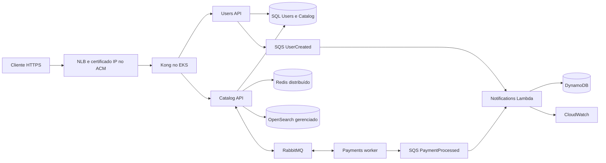

# Fase 4 — importação, operação e apresentação em vídeo

Atualizado em 11/11/2026, horário de Brasília. Este é o ponto de entrada da Fase 4 para uma pessoa ou IA sem a conversa original. Os documentos de Fase 3, Kind e antigos scripts `stage*` são históricos; não executar seus deploys, pauses de triggers ou `stop.ps1` no ambiente desta fase.

## Estado real e responsabilidade de quem continuar

**Ainda não está pronto para gravar.** Aplicações e rollout foram validados localmente; a criação e o aceite real na AWS dependem da janela autorizada. Não confundir fonte/template preparado com recurso criado ou teste cloud aprovado.

| Item | Estado deste snapshot |
|---|---|
| Runtime | .NET 10 nas APIs e na Lambda; .NET 8 da base foi substituído |
| Aplicação | Busca, sincronização durável, cache, eventos e migrations administrativas implementados |
| Validação local anterior | Users 38 + Catalog 83 testes; rollout real em Kind com chamadas contínuas sem falhas nas amostras registradas |
| Infraestrutura | CloudFormation/SAM, bootstrap YAML, IAM/RBAC, acesso privado e workflows preparados; revisão e QA incremental em andamento |
| AWS | Nenhum recurso desta fase criado; último saldo observado: USD 100 em plano FREE, em 11/11; reconfirmar antes de criar |
| Git | Branches F4 e PRs das quatro aplicações publicados; orquestração publicada junto deste guia. Conferir os SHAs/PRs abaixo; main ainda aguarda a janela operável |
| Evidências cloud | EKS/ECR/OpenSearch/HTTPS, dois Actions rollouts, cache e DynamoDB reais ainda pendentes |
| Vídeo e relatório | Vídeo ainda não gravado. O grupo fará o TXT com nomes completos e usernames Discord |

O usuário autorizou os cinco repositórios existentes, a identidade GitHub `leo-bernar` e sessões STS limitadas para os deploys. Commits publicados pelo conector confirmaram essa autoria. Não criar repositórios novos, trocar para plano Paid, cadastrar chaves permanentes ou passar credenciais pelo chat. A escrita GitHub conectada não disponibiliza automaticamente autenticação ao programa `gh` local.

**Janela aprovada:** 13/11/2026 20:00 a 18/11/2026 20:00, `America/Sao_Paulo`; em UTC, `2026-11-13T23:00:00Z` a `2026-11-18T23:00:00Z`. São 120 horas. Os scripts recusam alterações fora dessa janela. Preparação local, documentação e publicação de código podem ocorrer antes dela. Renovar o login AWS perto da abertura; uma sessão válida em 11/11 não garante acesso em 13/11.

Estimativa de planejamento: até USD 12/dia, aproximadamente USD 60/120 h, com USD 40 de reserva no saldo inicial. Não é teto garantido: tráfego, armazenamento retido, logs, tentativas e alterações de preço podem mudar o custo. Os gates exigem Free ativo, cobertura estimada e revisão atual de preços; não transformam um crédito promocional em cobrança zero garantida.

## O que o enunciado exige

Referência normativa: `TC NETT - Fase 4.pdf`, 7 páginas, SHA-256 `f2da2577050db424b13dfbf7c815aec252f1d7a531723b45a4c983a69d849535`. O original não acompanha o Git; não modificá-lo nem republicá-lo. A tabela registra os requisitos para permitir continuidade sem depender do caminho original.

| ID / página física | Obrigatório | Implementação e prova de aceite |
|---|---|---|
| INF-1 / 2–3 | Kubernetes gerenciado | EKS ativo e pods reais; Kind serve apenas a testes locais |
| INF-2 / 3 | Registry privado nativo | ECR privado; tags e digests usados pelos pods |
| INF-3 / 3 | Entrada externa por LB/Ingress | NLB → Kong; chamadas externas em HTTPS válido |
| DATA-1 / 3–4 | DynamoDB/MongoDB com driver oficial .NET | Lambda usa AWSSDK.DynamoDBv2; eventos realmente persistidos |
| DATA-2 / 4 | Redis/IDistributedCache reduzindo round-trips | Consultas frias/quentes com SELECTs, amostras de latência e invalidação |
| SEARCH-1 / 4 | Busca gerenciada independente do SQL | Amazon OpenSearch Service; não substituir por container OpenSearch no aceite |
| SEARCH-2 / 4 | Catalog sincroniza inserts/edits no índice | SQL/outbox de indexação + worker; criar/editar e observar resultado |
| SEARCH-3 / 4 | `/search`, fuzzy e relevância | Termo exato/erro de digitação; relevância e limite de 20 ativos |
| CICD-1 / 4–5 | Actions/Azure DevOps em Users e Catalog | Runs reais dos dois workflows |
| CICD-2 / 4–5 | Build, testes, Docker versionado, push, deploy; main=produção | SHA da main, tag/digest ECR, imagem do pod e X-Build-Sha correspondem |
| CICD-3 / 5 | Rolling Update sem downtime | Sampler externo durante atualização; registrar chamadas, falhas e versões |
| SEC-1 / 5 | Sem credenciais/strings de conexão hardcoded | Valores privados gerados fora do Git; revisar fonte, manifests renderizados e logs |
| SEC-2 / 5 | Secrets/integrador de segredos | Kubernetes Secrets e Pod Identity para AWS; CI não recebe credencial administrativa |
| ENT-1 / 5 | Vídeo até 25 min com todos os itens | Infra/pods, code change+push+live deploy, busca, cache e explicação NoSQL |
| ENT-2 / 5 | Código, IaC e pipelines YAML disponíveis | Cinco repositórios, manifests YAML/JSON, SAM e ci-cd.yml |
| ENT-3 / 6 | Relatório, nomes/Discord, links e README detalhado | Grupo completa seu TXT e vídeo/URL; conferir acessibilidade dos links |

O detalhamento aceita uma nuvem; não obriga duas nuvens, frontend ou Argo CD. Scan de imagens é desejável; ECR tem scan-on-push. Não inventar outras obrigações ou percentuais de desempenho. Preparação para gravação e entrega acadêmica completa são estados diferentes: a última exige o vídeo e os dados reais do grupo.

## Repositórios, importação e versões

Usar diretório novo para importar; preservar os checkouts com alterações locais. Os cinco projetos devem ser pastas irmãs:

```powershell
git clone --branch fase-4/apresentacao https://github.com/arthuurqueirozz/tech-challenge-2-users-api.git
git clone --branch fase-4/apresentacao https://github.com/arthuurqueirozz/tech-challenge-2-catalog-api.git
git clone --branch fase-4/apresentacao https://github.com/arthuurqueirozz/tech-challenge-2-payments-api.git
git clone --branch fase-4/apresentacao https://github.com/arthuurqueirozz/tech-challenge-3-notifications-function.git
git clone --branch fase-4/apresentacao https://github.com/arthuurqueirozz/tech-challenge-3-orchestration.git
cd tech-challenge-3-orchestration
```

Esses comandos pressupõem que a branch F4 já esteja publicada. Se não existir, retomar a publicação dos fontes preparados; não substituir silenciosamente por `main` F2/F3. Após a integração final, clonar `main` e conferir os SHAs de produção registrados abaixo. Preservar `fase-3` e as tags antigas. Na primeira integração das APIs, incorporar a F3 junto com a F4 sem force push e sem apagar histórico.

| Projeto | Base F3 preservada | Versão F4 publicada / produção |
|---|---|---|
| Users | 69f10707aeda2e7ec432c241f86120ffcf238183 | b06a08821090bb880c51b1515230ebcfbe501d67 — [PR1](https://github.com/arthuurqueirozz/tech-challenge-2-users-api/pull/1); merge/digest cloud pendentes |
| Catalog | b4bfa23edc192b952b44dc1a91f178eedb7e212e | 1424b2b5681a63a35d0ac5a690694da5ec1a2cec — [PR1](https://github.com/arthuurqueirozz/tech-challenge-2-catalog-api/pull/1); merge/digest cloud pendentes |
| Payments | 3ad9365d8729982961b88f405241ad7b910169a0 | 85a84c70dca37ee0e13e790f705e0336effb8809 — [PR1](https://github.com/arthuurqueirozz/tech-challenge-2-payments-api/pull/1); merge/digest cloud pendentes |
| Notifications | 89349f84f623a9f16322c8367e5a3909cae416a8 | ca49a27552fb23892b5ae0753e976cc7e7ff5a88 — [PR1](https://github.com/arthuurqueirozz/tech-challenge-3-notifications-function/pull/1); merge/pacote Lambda cloud pendentes |
| Orchestration | 1e743185381bc7489f9d085520371c9614cbdfef | Branch fase-4/apresentacao, [PR1](https://github.com/arthuurqueirozz/tech-challenge-3-orchestration/pull/1); obter SHA real com git rev-parse HEAD e fixar em ORCHESTRATION_REF; merge pendente |

O workspace autor tem código em `work/tech-challenge-fase-4/repos/` e evidências em `output/fiap-fase-4/`. Esses caminhos são contexto opcional; as instruções usam caminhos relativos aos clones para funcionar em outra máquina.

## Arquitetura e decisões que precisam ser explicadas



Users autentica com JWT e mantém identidade/outbox; Catalog controla jogos, biblioteca, compras, cache e busca. Payments processa eventos no RabbitMQ; no demo, valor até o limite configurado 100 é aprovado, acima dele é rejeitado. A Lambda simula notificações de boas-vindas/compra e registra o resultado; não envia e-mail externo. Redis é descartável. SQL é a fonte de verdade dos jogos e usuários. OpenSearch mantém uma projeção pesquisável; DynamoDB mantém eventos flexíveis e o resultado durável da simulação.

`GET /search?q=...` consulta OpenSearch, não SQL. Pesquisa título com peso 3, descrição e desenvolvedor, `fuzziness=AUTO`, relevância decrescente e ID como desempate; até 20 ativos. Branco/ausente retorna 400; sem resultado retorna `[]`; indisponibilidade do motor retorna 503. Busca não integra a readiness geral, permitindo operações independentes durante uma falha do motor.

Criar/editar/desativar grava estado e pendência de indexação na transação SQL. Worker interno envia o snapshot canônico com revisão, controla concorrência/metadados e mantém pendências em falhas. A consistência é eventual: medir o intervalo observado, sem prometer atualização instantânea. Bootstrap é administrativo, com escritores/workers controlados; não apagar índice em uso. `action.auto_create_index=false` evita recriação implícita sem mapping após perda do índice.

EKS usa um node m6a.xlarge, 4 vCPU/16 GiB, Ohio. É uma demonstração econômica em uma AZ de trabalho; o controle EKS usa duas subnets/AZs. Duas réplicas por API e surge 1 suportam rolling update quando há capacidade. Isso não oferece alta disponibilidade se o node ou a AZ falhar. SQL e Rabbit usam EBS gp3 criptografado com retenção; Redis e Prometheus/Grafana são efêmeros.

Namespaces: `fcg-users`, `fcg-catalog`, `fcg-platform`. Acesso de CI limitado ao próprio namespace e ECR; RBAC nega get/list de Secrets, pods/exec e administração da plataforma. Criar Jobs/alterar Deployment permite usar Secrets/SAs da própria API: a fronteira entre serviços é o namespace, sem promessa de isolamento dos segredos da própria aplicação contra seu deployer. Uma política de admissão impede Services externos nos dois namespaces de API. SQL `sa` fica na plataforma; quatro logins separam runtime/migration de Users/Catalog. Runtime tem datareader/datawriter do seu banco; migration tem db_owner somente nele.

Pods usam EKS Pod Identity: Users só publica em UserCreated; Payments só em PaymentProcessed; Catalog acessa somente seu índice. Os Jobs SQL não têm papel AWS. Um SA separado faz bootstrap do índice com o mesmo escopo de índice do Catalog.

GitHub runner acessa a API privada EKS por Session Manager no node. O documento fixa host EKS e porta 443; só a porta local 8443 é aceita. Kubeconfig aponta para loopback preservando CA e `tls-server-name` real; sem bypass TLS. Um documento separado de OpenSearch/9443 é exclusivo do operador. Substituição do node exige redescobrir InstanceId e atualizar gateway/acesso antes de renovar CI.

## Ferramentas e validação local

Operador: Windows PowerShell 5.1 ou PowerShell 7.5+, Git, .NET SDK 10, Docker, AWS CLI v2 com `aws login`, kubectl compatível com EKS 1.35, Session Manager plugin e, para configurar Secrets/Variables, GitHub CLI `gh` autenticado como `leo-bernar`. Scripts preservam timestamps ISO; não usar PowerShell 7.0–7.4 nos novos helpers. O workflow usa pwsh atual do runner Ubuntu.

No workspace original há AWS CLI em `work/tech-challenge-fase-4/tools/aws-cli/Amazon/AWSCLIV2/aws.exe`. Em outra máquina, usar instalação oficial. Definir `FCG_AWS_EXECUTABLE` com caminho absoluto se `aws` não estiver no PATH. Não versionar executáveis, pacotes locais, credenciais ou arquivos de estado.

```powershell
dotnet --version
docker version
aws --version
kubectl version --client
$pluginBin = ./scripts/install-ssm-plugin.ps1 -DestinationPath ../tools/ssm-plugin-1.2.896.0
$env:PATH = $pluginBin + [IO.Path]::PathSeparator + $env:PATH
session-manager-plugin --version

dotnet restore ../tech-challenge-2-users-api/TechChallenge.Users.sln
dotnet build ../tech-challenge-2-users-api/TechChallenge.Users.sln -c Release --no-restore
dotnet run --project ../tech-challenge-2-users-api/tests/FCG.Users.Tests/FCG.Users.Tests.csproj -c Release --no-build --no-restore
dotnet restore ../tech-challenge-2-catalog-api/TechChallenge.Catalog.sln
dotnet build ../tech-challenge-2-catalog-api/TechChallenge.Catalog.sln -c Release --no-restore
dotnet run --project ../tech-challenge-2-catalog-api/tests/FCG.Catalog.Tests/FCG.Catalog.Tests.csproj -c Release --no-build --no-restore
```

Os testes são executáveis xUnit; usar os comandos documentados, não inferir sucesso por um `dotnet test` que não executou casos. Ambiente local completo de busca: [SEARCH-LOCAL.md](SEARCH-LOCAL.md). Essa stack local não cria AWS; não executar junto com a cloud se não for útil. Preservar volumes antigos; não fazer `docker system prune --volumes`.

## Estado privado e preparação anterior à janela

Criar arquivo fora de qualquer checkout Git. Exemplo, a partir da orquestração:

```powershell
$statePath = Join-Path ([IO.Path]::GetTempPath()) 'fcg-fase4-private/state.local.json'
./scripts/prepare-cloud-settings.ps1 -StatePath $statePath
. ./scripts/cloud-common.ps1
$state = ConvertFrom-CloudJson -Json (Get-Content -LiteralPath $statePath -Raw -Encoding UTF8)
$state.AccountId = '668471253419' # conta verificada desta instalacao; conferir com STS
Write-CloudJson -Path $statePath -Value $state
```

A preparação gera apenas segredos ausentes, com RNG; não rotaciona os existentes. O exemplo usa a pasta temporária do usuário para evitar qualquer checkout Git, inclusive o marcador `.git` vazio do workspace original. Guardar cópia privada e preservá-la durante a demonstração: limpeza da pasta temporária pode apagar estado e material de recuperação. É possível escolher outra pasta privada persistente fora de qualquer árvore Git. Estado parcial/inválido deve ser recuperado, não regenerado por cima de SQL persistente. Arquivos são privados antes de receber conteúdo (ACL de usuário no Windows, modo 600/700 no Linux). Nunca imprimir `$state`, conteúdo de Secrets, kubeconfig raw, tokens ou senhas. O admin de demo usa e-mail sintético `admin@fcg.example.test`, não uma identidade de integrante.

```powershell
aws login --profile fiap-fase4
./scripts/provision-cloud.ps1 -Stage Discover -StatePath $statePath
```

Discover consulta STS/Free/quota/AZs/capacidade e registra o papel IAM completo (na conta original, `role/managed/AccountFullAccessRole`), CIDR público /32 e AZs reais. Não trocar o ARN pelo da sessão STS, não remover o caminho `managed/`, não presumir AZ pelo nome da região. Se login precisar do navegador, concluir sem colar códigos ou credenciais no chat.

Antes de Network, reconferir preços oficiais e registrar `PriceReviewObservedAtUtc` com a hora UTC real dessa consulta, usando `Write-CloudJson`. Não atualizar esse campo sem verificar os preços. Snapshot de 11/11: EKS USD0,10/h; m6a.xlarge0,1728/h; t3.small.search0,036/h; NLB0,0225/h +0,006/NLCU-h; EBS0,08/GB-mês; OpenSearch gp3 0,122/GB-mês; IPv4 0,005/h; ECR0,10/GB-mês. Somar armazenamento SQL/Rabbit/root/search, IPv4, tráfego, Lambda/SQS/Dynamo/S3/logs e reserva. Gates de timestamps rejeitam observação futura ou antiga. Não executar Network antes de 13/11 20h BRT.

## Sequência de criação dentro da janela

Executar em ordem; interromper na primeira falha. Scripts capturam erros sem despejar respostas privadas; investigar a fase/recurso com acesso administrativo privado. Não reaplicar tudo para contornar um erro nem apagar dados para resolver senha divergente.

```powershell
./scripts/provision-cloud.ps1 -Stage Discover -StatePath $statePath
# Revalidar precos/saldo e registrar a observacao real antes de Network.
./scripts/provision-cloud.ps1 -Stage Network -StatePath $statePath
./scripts/provision-cloud.ps1 -Stage Notifications -StatePath $statePath
./scripts/provision-cloud.ps1 -Stage Runtime -StatePath $statePath
```

Network cria VPC, EKS 1.35/node, ECR e bucket privado de artefatos. Não cria NAT nem outro node. Notifications publica código compilado `linux-x64` em ZIP, usa `aws cloudformation package` para SAM e implanta Lambda/SQS/DynamoDB; não enviar apenas fonte C# para Lambda. Os dois triggers devem ficar habilitados durante o aceite. Runtime verifica/pina versões de addons e cria Pod Identity/EBS CSI/associações. Conferir addons ACTIVE e permissão real; um preflight read-only não comprova criação.

Se OpenSearch service-linked role estiver ausente, criar somente a oficial e repetir Search; se houver negação Free/SCP, registrar e resolver sem trocar para Paid:

```powershell
aws iam create-service-linked-role --aws-service-name opensearchservice.amazonaws.com --profile fiap-fase4 --region us-east-2
./scripts/provision-cloud.ps1 -Stage Search -StatePath $statePath
./scripts/provision-cloud.ps1 -Stage Access -StatePath $statePath
```

Access descobre o único node do cluster, exige SSM Online/agente compatível e cria documentos de túnel e papéis limitados. Antes de CI, comprovar que os papéis negam SSM sem documento, documento de shell, host/porta alternativos, SendCommand, namespace alheio, Secrets, administração e Services LoadBalancer. Uma política local correta não substitui testes reais de negação.

Publicar imagens iniciais a partir de checkouts limpos dos **SHAs F4 revisados**, em pastas separadas dos fontes em edição. O script recusa checkout sujo ou SHA diferente. Informar SHA real na variável, sem inventá-lo:

```powershell
$usersSha = (& git -C ../tech-challenge-2-users-api rev-parse HEAD).Trim()
$catalogSha = (& git -C ../tech-challenge-2-catalog-api rev-parse HEAD).Trim()
$paymentsSha = (& git -C ../tech-challenge-2-payments-api rev-parse HEAD).Trim()
$orchestrationSha = (& git rev-parse HEAD).Trim()
# Conferir esses SHAs contra as versoes revisadas antes de publicar imagens.
./scripts/publish-cloud-image.ps1 -StatePath $statePath -Service users -SourceDirectory ../tech-challenge-2-users-api -BuildSha $usersSha
./scripts/publish-cloud-image.ps1 -StatePath $statePath -Service catalog -SourceDirectory ../tech-challenge-2-catalog-api -BuildSha $catalogSha
./scripts/publish-cloud-image.ps1 -StatePath $statePath -Service payments -SourceDirectory ../tech-challenge-2-payments-api -BuildSha $paymentsSha
$state = Read-CloudState -Path $statePath
$state.SourceCommits | Add-Member -NotePropertyName orchestration -NotePropertyValue $orchestrationSha -Force
Write-CloudJson -Path $statePath -Value $state

./scripts/provision-cloud.ps1 -Stage Platform -StatePath $statePath
./scripts/configure-cloud-search.ps1 -StatePath $statePath
./scripts/provision-cloud.ps1 -Stage SearchBootstrap -StatePath $statePath
./scripts/provision-cloud.ps1 -Stage Apis -StatePath $statePath
```

Platform aplica namespaces, política de admissão, RBAC, Secrets/ConfigMaps, volumes e dependências. Compara todos os Secrets antes de gravar; divergência aborta sem rotação. SQL cria/confere os quatro logins/bancos sem imprimir senhas. SearchSettings usa túnel separado + SigV4 com certificado real e confirma `auto_create_index=false`. Bootstrap exige Catalog parado, prepara schema/mapping/pendências; não apaga índice. Apis executa migrations por Job e depois rollout. Esse primeiro bootstrap sem URL externa **não é aceite final de CI/CD**.

## HTTPS gratuito sem domínio

O usuário não possui domínio. A solução usa certificado público Let's Encrypt para o IPv4 elástico do NLB, perfil shortlived, importado ao ACM. Emitir perto do início da janela e conferir validade até 18/11 20h BRT. Certificado staging não é confiável para apresentação.

```powershell
./scripts/provision-cloud.ps1 -Stage GatewayChallenge -StatePath $statePath
./scripts/provision-cloud.ps1 -Stage Certificate -StatePath $statePath
./scripts/provision-cloud.ps1 -Stage GatewayHttps -StatePath $statePath
```

GatewayChallenge primeiro instala **somente a rota ACME**, reinicia/aguarda Kong e depois abre HTTP80. O solver Certbot atende apenas o desafio. Durante essa etapa, não há login ou negócio público em HTTP. O emissor testa staging e depois produção, guarda arquivos com ACL, valida IP/chave/cadeia/prazo e grava `CertificateArn`. GatewayHttps remove listener/ingresso80, confirma sua ausência e só então ativa rotas de negócio com JWT na configuração Secret do Kong. Falha mantém challenge-only; não resolver usando `-k`, certificado inválido ou abrindo negócio em HTTP.

Validar `https://<IP real>/status/users`, `/status/catalog` e `/search?q=...` com validação TLS normal. Conferir NotAfter, IP SAN e certificado importado/associado. O IP não está disponível antes da criação real; não há URL pública de demo neste snapshot.

## CI/CD real de Users e Catalog

Cada `.github/workflows/ci-cd.yml` executa restore/build/testes em PR/push. Push em `main` também constrói Docker, usa tag SHA+run+attempt, publica ECR, resolve digest e executa Job de migration → Rolling Update → smoke externo com SHA. As imagens da branch de preparação servem ao bootstrap; para o vídeo, integrar os PRs e demonstrar a automação real da main dos dois serviços.

CI remota dos PRs já comprovada: [Users, run 43123879873](https://github.com/arthuurqueirozz/tech-challenge-2-users-api/actions/runs/43123879873) e [Catalog, run 43123912102](https://github.com/arthuurqueirozz/tech-challenge-2-catalog-api/actions/runs/43123912102) concluíram restore/build/xUnit com sucesso nos SHAs F4 da tabela. O job deploy foi `skipped` por serem PRs, como previsto; esses runs não criaram nem atualizaram AWS.

Instalar GitHub CLI oficial e executar `gh auth login --hostname github.com --web` como `leo-bernar`, se ainda não estiver autenticado. Não copiar tokens do conector ou da AWS para o chat. Com HTTPS funcional e orquestração revisada/publicada:

```powershell
./scripts/renew-cloud-deploy-session.ps1 -StatePath $statePath -Service users -OrchestrationRef $orchestrationSha
./scripts/renew-cloud-deploy-session.ps1 -StatePath $statePath -Service catalog -OrchestrationRef $orchestrationSha
```

O script verifica identidade/alvos, assume só `fiap-f4-users-deploy` ou `fiap-f4-catalog-deploy`, envia três Secrets por stdin e Repository Variables via gh. Nunca envia `AccountFullAccessRole`. A sessão dura até uma hora e precisa de pelo menos 20 min restantes ao iniciar publicação/deploy; renovar imediatamente antes dos dois testes/gravação. Expiração não desliga os pods em execução.

Variables: AWS_ACCOUNT_ID, AWS_REGION=`us-east-2`, AWS_SESSION_EXPIRES_AT (expiração real ISO), ECR_REPOSITORY, EKS_CLUSTER_NAME, K8S_NAMESPACE=`fcg-users`/`fcg-catalog`, SSM_NODE_INSTANCE_ID, SSM_TUNNEL_DOCUMENT_NAME=`fcg-fase4-eks-tunnel`, ORCHESTRATION_REPOSITORY, ORCHESTRATION_REF (40hex fixo), SMOKE_URL HTTPS da própria API. Secrets: AWS_ACCESS_KEY_ID, AWS_SECRET_ACCESS_KEY, AWS_SESSION_TOKEN. Se orquestração for privada, também providenciar ORCHESTRATION_READ_TOKEN somente leitura; o token padrão de outra repo não basta.

Provar as duas pipelines em cloud. Para cada uma, anotar run URL, SHA da main, tag/digest ECR, imagem dos pods, X-Build-Sha, migration completa, rollout e smoke. Conferir esses valores após o merge; a main deve refletir a versão implantada. PR CI verde sozinho não comprova deploy. Não renovar credenciais durante uma execução já iniciada nem fazer push durante atualização parcial de Secrets.

## Ensaio funcional com dados sintéticos

Fazer o ensaio antes da gravação. Variáveis de credenciais ficam apenas na memória da sessão privada, sem transcript, `Write-Host`, captura de tela ou histórico contendo valores literais.

```powershell
. ./scripts/cloud-common.ps1
$state = Read-CloudState -Path $statePath
$url = $state.GatewayOutputs.PublicUrl.TrimEnd('/')
$adminLogin = @{ email=$state.Secrets.AdminSeedEmail; password=$state.Secrets.AdminSeedPassword } | ConvertTo-Json
$auth = Invoke-RestMethod -Method Post -Uri "$url/api/auth/login" -ContentType application/json -Body $adminLogin
$adminHeaders = @{ Authorization='Bearer ' + $auth.accessToken }

$gameBody = @{title='Stellar Quest';description='Exploracao espacial';developer='FCG Demo';price=59.90} | ConvertTo-Json
$game = Invoke-RestMethod -Method Post -Uri "$url/api/games" -Headers $adminHeaders -ContentType application/json -Body $gameBody
Invoke-RestMethod -Uri "$url/search?q=stellar"
Invoke-RestMethod -Uri "$url/search?q=stelar"
```

Criar segundo jogo com `stellar` apenas na descrição para comparar com título; verificar a ordem real do dataset. Editar o título com PUT `/api/games/{id}`, corpo title/description/developer/price; consultar o termo novo até refletir a mudança, com timeout e intervalo registrados. DELETE desativa; conferir que sai da busca. Não afirmar que a primeira consulta após POST já contém o item.

Registrar um usuário sintético com POST `/api/auth/register`, corpo name/email/password gerados para esse ensaio; resposta tem accessToken e user.id. Usar e-mail do domínio reservado `fcg.example.test`, senha RNG e guardar token somente em variável. Conferir GET `/api/me/profile` e que User não consegue POST de jogo. Sem JWT, compra/perfil devem ser negados. Não usar cadastro real de aluno para gerar prova.

Compra: POST `/api/me/library/games/{gameId}` com Bearer do usuário; retorna orderId e estado inicial. Esperar processamento e consultar GET `/api/me/library/games`. Jogo de 59,90 deve entrar após aprovação. Outro jogo de 150 deve gerar rejeição e ficar fora. Não comprar duas vezes o mesmo jogo/usuário para produzir os dois casos. Registrar HTTP/status/IDs sintéticos/horários; nunca o token.

NoSQL: confirmar ambos event-source-mappings habilitados, logs CloudWatch `SimulationRecorded` e itens da tabela `NotificationsOutputs.EventsTableName` (conferir o nome real do output). DynamoDB contém EventKey, EventType, ProcessingStatus=Completed, NotificationKind/NotificationState, Fingerprint e Data (mapa flexível). Buscar o registro por UserId/OrderId sintéticos. O evento aprovado gera PurchaseConfirmation/Simulated; rejeitado gera None/Skipped. `attribute_not_exists(EventKey)` e fingerprint tornam repetição idempotente e detectam conflito. Não apresentar envio de e-mail real: trata-se de simulação persistida.

## Medição do cache e continuidade

Cache medido em GET `/api/games`, não em `/search`. O cache é compartilhado pelas réplicas, com TTL de 60 s. Fazer aquecimento de aplicação/JIT antes das amostras. Em janela controlada sem outros clientes, registrar cinco leituras frias e pelo menos vinte quentes equivalentes; guardar todas as durações, mediana, quantidade e erros.

Para contar SELECTs, o operador pode habilitar temporariamente `Serilog__MinimumLevel__Override__Microsoft.EntityFrameworkCore.Database.Command=Information` no Deployment Catalog, aguardar rollout e coletar logs de **todos** os pods. Não habilitar sensitive-data logging. Contar somente SELECTs da tabela Games; healthchecks e worker produzem outras consultas. Registrar contador antes/depois de cada fase, pod UIDs e horários; se pods reiniciarem ou houver tráfego concorrente, repetir o ensaio controlado sem apresentar o resultado incomparável como ganho.

Remover somente a chave `fcg:catalog:v1:games:active:title-asc` com `redis-cli DEL` no pod Redis antes de cada amostra fria. Não executar FLUSHALL/FLUSHDB. Pré-preencher a chave uma vez antes das leituras quentes e terminar antes do TTL, sem criação/edição concorrente. Medir latência com Stopwatch em torno da mesma requisição externa e confirmar respostas equivalentes. Comparar SELECTs: frio consulta SQL; quente deve reutilizar cache. Editar um jogo ao final e provar invalidação/novo resultado; restaurar a configuração de logging temporária. Mostrar números reais, mesmo que a diferença de latência seja pequena; não inventar percentual nem escolher só as amostras favoráveis.

Para rollout, manter sampler externo chamando `/status/users` ou `/status/catalog` com timeout enquanto faz o push. Registrar início/fim, HTTP, duração e X-Build-Sha; parar após estabilizar a nova versão. A prova local anterior não substitui essa medição pelo NLB. Guardar CSV/JSON agregado sem tokens. A execução deve observar versão antiga e nova e explicar qualquer falha; não marcar sem downtime se o registro não sustentar isso. Fazer o ensaio nas duas APIs, ainda que só uma apareça em detalhe no vídeo.

O workspace original possui sampler .NET em `work/tech-challenge-fase-4/tools/qa-deploy`, configurado por QA_URL, QA_SECONDS, QA_EXPECTED_OLD, QA_EXPECTED_NEW e QA_OUTPUT_PATH. Não depender desse binário em outra máquina: implementar/coordenar chamadas periódicas equivalentes se a ferramenta não acompanhar a importação. Nunca desabilitar TLS para usá-lo na cloud.

## Roteiro do vídeo — meta 23 minutos, máximo 25

Preparar abas do console AWS Ohio (EKS/nodes, ECR e OpenSearch), kubectl privado, GitHub Actions e terminal de requisições. Preparar os Secrets antes de compartilhar a tela. Não abrir state, Secret YAML, auth response, kubeconfig raw, token ou chave ACM. Ensaiar a duração real da pipeline e reservar margem.

| Tempo | Mostrar e explicar |
|---|---|
| 0–3 min | Problema, cinco repos, arquitetura; o que veio da F3 e o que mudou na F4 |
| 3–6 min | Console EKS gerenciado, nodes/pods; ECR privado com digests; OpenSearch gerenciado; entrada NLB/HTTPS |
| 6–13 min | Mudança pequena de código em Users ou Catalog, commit/push na main; Actions build/test/tag/push; Job migration e pods em Rolling Update; sampler e novo X-Build-Sha. Mostrar também a evidência do outro serviço |
| 13–17 min | Criar jogo, `/search` com erro de digitação e relevância; editar e observar sincronização; explicar SQL/outbox e consistência eventual |
| 17–20 min | Frio/quente do mesmo endpoint; SELECTs, latências/medianas reais; invalidar por edição; explicar Redis entre réplicas |
| 20–23 min | Cadastro/compra → SQS/Lambda/DynamoDB; item flexível e idempotência; explicar uso do driver oficial .NET e simulação; apontar README/repos/links |

A alteração do live deploy deve ser de código, pequena e reversível, sem mudança destrutiva de schema. Por exemplo, acrescentar um campo informativo ao JSON de status preservando service/status; não mudar apenas tag de imagem ou variável e chamá-lo de alteração de código. Commit deve passar revisão e CI. Caso se escolha esse exemplo, atualizar testes afetados pelo contrato e registrar o SHA novo; não fingir pipeline ao vivo com execução antiga.

O vídeo precisa mostrar o push e seu resultado real, sem forjar êxito ou mascarar erros. Se a pipeline demorar além da margem, ajustar o roteiro após ensaio. Depois da gravação, o grupo publica em YouTube/Google Drive com acesso para avaliador, completa seu TXT/relatório com nomes/Discord, links e resultados e confere o limite de 25 minutos.

## Recuperação e encerramento

Sessão expirada: renovar login operador e/ou STS restrita com o script correspondente; não inserir admin no CI. Permissão negada: identificar fase/ARN/namespace e corrigir o escopo mínimo; não abrir API EKS para 0.0.0.0/0. Tunnel ocupado: identificar o processo próprio; não matar processos alheios. Node trocado: redescobrir por Access e atualizar Gateway e variáveis CI. Serviço não pronto: conferir probes, PVC/AZ, addons, SQL/migrations e recursos disponíveis.

Migration falhou: deployment anterior continua; investigar Job/banco e usar novo DeploymentId após correção. Não apagar Job ativo nem fazer Down/drop automático. Rollout/smoke falhou após aplicar: recuperar imagem conhecida compatível e reconciliar main por revert/correção+pipeline; schema precisa continuar compatível. Search fora: endpoint503/pending preservada; corrigir conexão/identidade, não recriar índice em uso. Secrets divergentes: recuperar/importar valores reais do ambiente, sem rodar prepare para trocar senha de SQL persistido.

Às 18/11 20h BRT, exportar evidências, inventário, digests e configurações; preservar backup SQL e dados que o grupo precisar. Registrar plano/saldo final e recursos remanescentes. Os guards de janela impedem novos deploys; **não há desligamento automático configurado neste snapshot**. Executar o encerramento é obrigatório para respeitar a janela financeira. Parar pods, pausar Lambda ou deletar stack com Retain não encerra todos os custos.

Ordem de encerramento a executar com inventário real: retirar/expirar Secrets CI; remover gateway/NLB e liberar EIP; remover access stack; remover associações/addons/runtime; tratar domínio OpenSearch; remover nodegroup/EKS; tratar rede; inventariar EBS, ECR, bucket S3 de pacotes, DynamoDB, SQS e logs retidos. O índice é projeção reconstruível do SQL, mas sua exclusão precisa preservar mapeamento/evidência e respeitar dados que devam ser guardados. SearchDomain e seu SG têm Retain: deletar somente sua stack mantém o domínio cobrando e pode bloquear remoção da VPC. Não declarar encerrado sem conferir o domínio real.

Volumes SQL/Rabbit, registros DynamoDB e demais dados retidos não devem ser apagados indiscriminadamente. Fazer backup verificável antes de qualquer descarte de dados e resolver a retenção final com o responsável. Mesmo sem compute, volumes/ECR/S3/logs podem consumir saldo. Não excluir recursos de outros projetos ou usar filtros genéricos sem conferir IDs/tags. O Free plan continua sendo Free; não migrar para Paid para prolongar demonstração.

## Registro que falta preencher antes de declarar pronto

- [ ] Revisão independente e QA aprovam os arquivos finais por hash/commit, inclusive PS5/PS7 e TLS.
- [ ] Cinco branches/PRs F4 publicados; main integrada preservando F3 e igual à produção.
- [ ] Free/saldo/preço/cobertura reconfirmados dentro da janela; criação/permissões efetivamente testadas.
- [ ] EKS/ECR/volumes/addons/identidades/SSM/RBAC/admissão e negativas reais verificados.
- [ ] OpenSearch gerenciado com configuração/mapping; fuzzy/relevância e sincronização observadas.
- [ ] HTTPS público normal válido até o fim; HTTP80 fechado antes de rotas de negócio.
- [ ] Jornadas Users/Catalog/Payments/NoSQL funcionam; triggers habilitados; dados persistem conforme esperado.
- [ ] Cache tem amostras, menos SELECTs, invalidação e impacto medidos.
- [ ] Dois deploys Actions reais correspondem à main e ao ECR; rollout externo registrado sem falhas atribuíveis à troca.
- [ ] Links, SHAs, digests, URL/IP, validade TLS e caminhos de evidência real preenchidos neste documento.
- [ ] Roteiro ensaiado até 25min, segredos ocultos, recuperação/encerramento claros.

Só então escrever **pronto para gravação**. Após vídeo/URL e TXT/relatório do grupo, conferir ENT-1/ENT-3 e registrar a entrega acadêmica; não antecipar essa conclusão.

## Fontes oficiais de operação

[EKS Pod Identity](https://docs.aws.amazon.com/eks/latest/userguide/pod-id-how-it-works.html), [Session Manager plugin](https://docs.aws.amazon.com/systems-manager/latest/userguide/session-manager-working-with-install-plugin.html), [AWS CLI package para SAM](https://docs.aws.amazon.com/cli/latest/reference/cloudformation/package.html), [certificados IP no Certbot](https://letsencrypt.org/2026/03/11/shorter-certs-certbot.html), [EKS pricing](https://aws.amazon.com/eks/pricing/), [OpenSearch pricing](https://aws.amazon.com/opensearch-service/pricing/), [GitHub CLI](https://cli.github.com/), [migrations EF](https://learn.microsoft.com/en-us/ef/core/managing-schemas/migrations/applying), [JSON no PowerShell](https://learn.microsoft.com/en-us/powershell/module/microsoft.powershell.utility/convertfrom-json).
